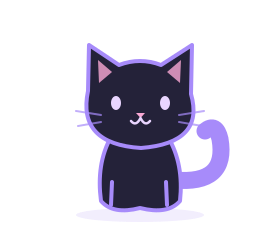

 

**작은 아이디어를 코드로 만듭니다.**

웹 서비스를 만들며 배우고 있습니다.  
직접 부딪힌 문제와 해결 과정을 코드와 글로 남깁니다.

 

 
 

[Blog ↗](https://cvri.tistory.com/) &nbsp; · &nbsp; [Projects ↗](https://github.com/cari-0?tab=repositories)

